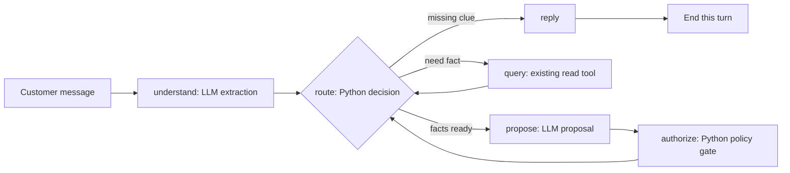

# Retail LangGraph orchestration

This is a **running six-node LangGraph**, not just a diagram. The diagram is:
`compiled_graph.mmd` is exported from the actual compiled graph.



`ChatState` holds messages, one shared customer lookup, a list of requests
(each has its own order/coupon facts), the next step, the model's proposal,
the reply, and CP1/CP2 event records. `SqliteSaver` stores this state by
`thread_id` between customer turns. The source-linked policy gate re-reads
the business DB before any simulated action is recorded.

`build_graph` accepts an interpreter with `extract` and `propose` methods.
`OpenAIInterpreter` is the real model adapter; tests inject a scripted fake
so they check graph routing without paid model calls. The adapter requires
`OPENAI_API_KEY` and defaults to `gpt-5.4-mini`. Set `RETAIL_AGENT_MODEL` only
to override that choice. It has been exercised in a small live smoke run;
see [`docs/STATUS.md`](../../docs/STATUS.md) for the observed limits. No current model or fixture is hidden in
the graph. The package dependency is in the workspace `pyproject.toml` under
the `llm` extra.

`run_chat.py` is a small local text-chat entrypoint using the real adapter.
It writes conversation checkpoints to `outputs/retail_graph_demo/chat_state.sqlite`
and simulated actions to `outputs/retail_graph_demo/actions.sqlite`. Running
it requires the model settings above; coupon checking also requires the local
Oracle HTTP service running. Reuse `--thread-id` to continue the same chat.
Run it from the workspace root after configuring `OPENAI_API_KEY`:

```powershell
.\.venv\Scripts\python -m agent.retail_graph.run_chat --thread-id demo-1
```

The eight-intent smoke runner uses disposable local Oracle databases and a
local HTTP server. Its default mode checks all business and coupon fixtures
without a model call. `--scripted` also exercises the full graph, CP1 routes,
CP2 gate results, and simulated action ledger with predictable model outputs.
`--live` runs the same eight synthetic messages through the configured model.
Each run writes a JSON report under
`outputs/retail_graph_demo/smoke_report.json` by default. The scripted checks
are not a measurement of LLM accuracy or reviewed ABCD gold labels.

```powershell
.\.venv\Scripts\python -m agent.retail_graph.smoke_agent
.\.venv\Scripts\python -m agent.retail_graph.smoke_agent --scripted
.\.venv\Scripts\python -m agent.retail_graph.smoke_agent --live
```

Live mode requires `OPENAI_API_KEY` in the local environment. Do not put the
API key in the report or repository. It makes
model API calls; the local Oracle and action ledger still use synthetic data.
From the workspace root, `run_live_smoke.ps1` prompts for the API key with
hidden input, runs `gpt-5.4-mini`, and clears the process environment afterward.
The key is not written to a file or command history.

The current graph has six nodes: `understand`, `route`, `query`, `propose`,
`authorize`, and `reply`. `query` dispatches to `lookup_customer`,
`lookup_order`, or `check_coupon`. The model never calls `ActionLedger`.
Normal questions end the current graph run and wait for the next customer
message on the same thread. Multi-intent messages become separate request
entries. CP1 records route choices before queries; CP2 records proposals and
the policy gate outcome. These evaluation events are distinct from LangGraph's
runtime SQLite checkpoints.

Run the graph integration tests from the workspace root:

```powershell
.\.venv\Scripts\python -m unittest -v agent.retail_graph.test_graph
```

Known boundaries: coupon replacement cannot be recorded yet; the ABCD promo
cases still need linked checkout fixtures. The current business DB lacks
receipt evidence and verified shipping-fee amounts. Return and non-Gold
upgrade actions require backend-confirmed customer details; the graph's
default context intentionally supplies none, so those actions remain blocked
until the future chat backend supplies that context. The test fake is not a
real agent evaluation or gold set.
