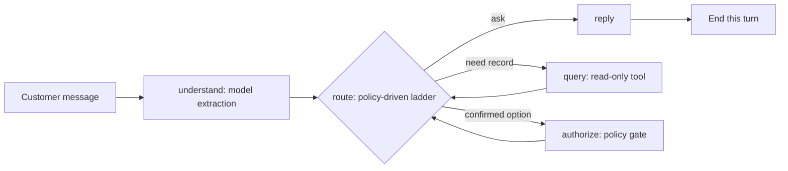

# Retail LangGraph orchestration

A running five-node LangGraph: `understand`, `route`, `query`, `authorize`,
`reply`. `compiled_graph.mmd` is exported from the compiled graph. See
[`docs/WORKFLOW.md`](../../docs/WORKFLOW.md) for the route ladder and who
decides what.



`ChatState` holds messages, identity claims and the verified customer, a
list of requests (each with its targets, fetched records, customer
statements, offered options, choice, and confirmation), the reply, and
CP1/CP2 event records. `SqliteSaver` stores it by `thread_id`.

`build_graph(interpreter, policy_gate, checkpointer, ...)` needs an
interpreter with one method, `extract`. `OpenAIInterpreter` is the real model
adapter (`OPENAI_API_KEY`; default model `gpt-5.4-mini`, override with
`RETAIL_AGENT_MODEL`). It only fills a fixed schema and receives no policy
text. Tests inject scripted interpreters.

## Run

```powershell
# Local chat with the real model (coupon checks need the Oracle server running)
.\.venv\Scripts\python -m agent.retail_graph.run_chat --thread-id demo-1

# Ten multi-turn smoke conversations, deterministic interpreter
.\.venv\Scripts\python -m agent.retail_graph.smoke_agent --scripted

# Same customer turns through the real model
.\.venv\Scripts\python -m agent.retail_graph.smoke_agent --live

.\.venv\Scripts\python -m unittest -v agent.retail_graph.test_graph
```

The smoke runner starts a disposable local Oracle HTTP server and writes a
report to `outputs/retail_graph_demo/smoke_report.json`. Scripted runs check
wiring and policy outcomes, not language understanding. Live mode has not
been re-run since the policy-v1 redesign.
