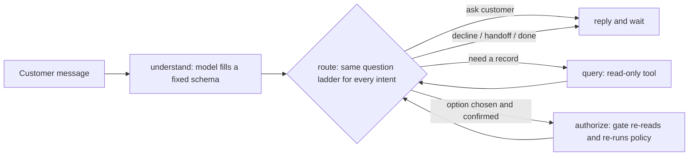

# Agent workflow (policy v1)

This document describes the **implemented** backend after the policy-v1
redesign. The policy file is the single source of truth; the graph contains
no intent-specific branches.

## Responsibilities

| Component | Decides | Never decides |
| --- | --- | --- |
| `llm_interpreter.py` (model) | What the customer said: identity details, new requests, order/item/coupon, answers to questions, option choice, yes/no | Eligibility, amounts, payloads, which tool to call |
| `agent/policy/engine.py` | Which facts are still needed, and whether the policy declines, hands off, or offers options with exact payloads | Anything about language |
| `graph.py` `route` | The next step, by asking the policy engine | Policy content |
| `policy_gate.py` | Whether a confirmed option is still allowed after re-reading records | Which option the customer wants |
| `action_ledger.py` | Nothing; it verifies and records | — |

## The route ladder

Every turn, for the first open request:

1. Is there a request? If the customer raised something outside the eight
   intents, say so right away and record a handoff.
2. Is the customer verified? Policy methods: email, or full name + zip code.
   An account ID alone is not enough. Once verified, identity is locked for
   the conversation.
3. Are the targets known? Order ID (then `lookup_order`), item (matched by
   name or the only item), coupon code.
4. Does the engine have every fact it needs? System facts come first
   (`lookup_order`, `check_coupon`); if a system record has no value and the
   policy allows it, the customer is asked. Only facts that can still change
   the outcome are asked.
5. Decision: `decline` explains and closes the request; `handoff` closes it
   for a human; `options` are offered.
6. The customer picks an option and says yes; then `authorize`. "No" closes
   the request with no change. New details after an offer (another item, a
   different answer) make the engine decide again.

Requests are handled one at a time; a resolved, declined, or handed-off
request moves on to the next one in the same turn.

## What is recorded

Every event carries `turn`, the 1-based index of the customer message it
belongs to, so an evaluation can line events up with the conversation.

* `extract_events`: one entry per customer message: the message, what the
  model extracted (`parsed`), the requests it raised, and the request its
  details were applied to. This is the only place the model's own output is
  recorded.
* `cp1_events`: one entry each time `route` ends a step: request, intent,
  next step, planned tool with its `arguments`, and what was asked
  (`identity`, `order_id`, `item`, `coupon_code`, `facts:<names>`,
  `choose_and_confirm`, `confirm`).
* `cp2_events`: each policy decision and each authorization:
  * `options`: rule ID, `facts_used` (value and source of every fact the
    rule read), and each option's `option_id`, `action`, and `payload`;
  * `declined` / `handoff`: rule ID, reason code, `facts_used`;
  * `customer_declined`: the customer said no or withdrew;
  * `authorize`: chosen option, action, payload, `confirmed`, and the gate's
    outcome, reason code, and rule ID.
* Ledger (`action_events_v2`): exactly one final row per request:
  `simulated`, `blocked`, `declined`, `customer_declined`, or `handoff`, with
  the policy rule ID and policy version.

## Evaluation design

`route` and the policy engine are deterministic: the same state always gives
the same next step and decision. The model in `understand` is the only part
that can vary, so both checkpoints are defined around what the model reads
and what that leads to.

### CP1: information gathering

*When:* each time the agent is about to query a tool or ask the customer.

*Question:* did the model read the identity, request, order, item, or
coupon correctly, and did that lead to the right tool with the right
arguments, or the right question?

*Reads:* `extract_events`, `cp1_events`.

*Metrics:* extraction accuracy per field; next-step accuracy (step, tool,
arguments, or `asked`).

### CP2: decision and action

*When:* each time the policy engine reaches a decision (options, decline,
handoff), and each time an action is about to be written.

*Question:* given the **true** facts of the case, which decision should the
policy reach, and did the agent reach it? Was an action executed only for the
option the customer actually chose, only after an explicit yes, with the
exact payload?

*Model's role here:* reading the customer's answers to policy questions
(receipt, purchase date), the option choice, and yes/no.

*Reads:* `extract_events`, `cp2_events`, the ledger.

*Metrics:* decision accuracy (kind and rule); payload exact match;
**unconfirmed actions** (an action written without a real yes; target 0);
unnecessary handoffs.

A CP2 failure has one of three causes, and the case records separate them:
the policy transcription is wrong (the reference label and the engine
disagree on the true facts), a fact was misread, or consent was misread.

### Full conversations

A model plays the customer from a case script (identity, order, request,
hidden facts such as having a receipt, and preferences such as which option
to pick or whether to back out) and talks to the agent until the requests
are closed or a turn limit is reached. Score: final ledger rows against the
expected outcome. Failures are traced back to the CP1 or CP2 event where
they started. `customer_simulation/rewritten_conversations.jsonl` can seed
the simulated customer's style; `multi_request_cases.jsonl` gives openers
with several requests.

### Cases

CP1 and CP2 cases start from a LangGraph checkpoint: a scripted conversation
is run up to a chosen point (for example, options just offered), and the case
forks from that state with one new customer message. Each case records:

* the synthetic customer, order, and intent;
* the **true facts** (including ones only the customer knows) and the
  customer's real intent for this message;
* the stop point and the new message;
* expected extraction, expected next step (CP1), and expected decision and
  action (CP2).

Messages vary: plain answers, paraphrases, vague replies ("I think so?"),
corrections (a different order ID), two requests in one message, backing out,
and attempts to override records ("I'm a Gold member", when the record says
Silver).

### Labels

* CP1 and full-conversation labels follow from how the case was built
  (the intended content of each message); a person spot-checks them.
* CP2 reference decisions are produced by a model that reads only
  `raw_data/guidelines.json` and the true facts, not `policy_v1.json` or the
  engine. Where it disagrees with the engine, a person decides. This review
  is also the review of policy v1; once settled, those cases become unit
  tests for the policy file.
* The labeling model should differ from the agent's model.

Target size: about 120 cases across the eight intents (roughly 60 CP1,
40 CP2, 20 full conversations). Where time allows, the CP2 cases are also run
against the 2026-11-08 backend (commit `0403464`), in which the model chose
the action, as a baseline.

## Known limits

* The model adapter is schema-only and has not been re-run live after the
  redesign. Replies are templates, not model-phrased.
* Customer statements (receipt, purchase date) are accepted and labeled
  `source=customer`; there is no evidence upload.
* No supervisor-approval tier; v1 has confirm-then-execute and handoff only.
* Oracle fixtures are still project-made and not linked to all ABCD promo
  cases; for guests without a usable Oracle verdict the request is handed off.
