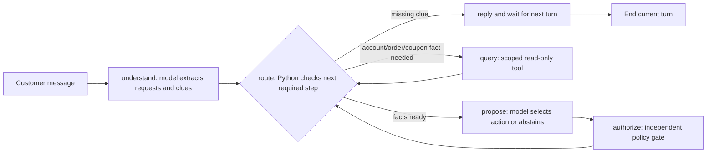

# Current agent workflow and evaluation checkpoints

This document describes the **implemented** backend. It reconciles the
earlier two-checkpoint design with the compiled graph in
[`agent/retail_graph/graph.py`](../agent/retail_graph/graph.py).

The state contains the dialogue, one account candidate, a list of separate
requests, each request's order/coupon facts, a proposed action, and CP1/CP2
event arrays. `SqliteSaver` persists the state by `thread_id`, so another
conversation does not inherit it. **LangGraph runtime checkpoints** are
saved state snapshots; **CP1/CP2** below are evaluation moments in our
business workflow. They are different concepts.

## What happens in one turn

1. `understand` asks the model to recognize one or more of the eight intents
   and extract only customer-provided clues. It never treats a model-created
   order ID or coupon code as verified. A new need becomes a separate request
   entry in the same chat.
2. `route` uses a small explicit decision tree. If an account clue, return
   problem description, order ID, coupon code, or item selection is missing,
   the agent asks for it and stops that turn. Otherwise it chooses exactly
   one permitted query: `lookup_customer`, `lookup_order`, or `check_coupon`.
3. `query` runs the selected read-only backend tool and returns its result to
   state. The graph loops back to `route` to decide whether another fact is
   needed. Coupon requests are the only branch that goes through the local
   platform checkout attempt and Oracle merchant check. A coupon complaint
   may have no order because checkout failed.
4. `propose` gives the model the applicable source-linked policy rules and
   queried facts. It returns a structured action and exact parameters, or
   abstains. The model does not write to a database.
5. `authorize` re-reads the business SQLite facts, checks the rule and exact
   payload, and records an allowed or blocked **simulated** event. Missing
   policy coverage or unconfirmed authority becomes a handoff. The agent's
   reply reports the outcome; it never claims a real refund or order change.

## CP1: before a query or question

`cp1_events` records the request, intent, next step, planned tool, and missing
clue/problem each time `route` runs. Future labels should check whether the
agent identified all needs, used only customer-provided clues, asked the right
question, and selected the right tool and parameters. A route may run more
than once per turn because each tool result returns to it.

## CP2: before and after a proposed action

`cp2_events` records the model proposal and the backend gate outcome, reason,
and policy rule ID. Future labels should check policy applicability, fact
sources, action type, exact item/amount/date parameters, abstention, and
customer explanation. The gate is a safety boundary, not a substitute for
evaluating whether the model proposed the best next step.

## Implemented limits

- The first version routes directly to the small policy JSON subset for a
  recognized intent; there is no vector RAG or general document retrieval.
- A unique synthetic account lookup and matching order are **not production
  identity authentication**. A logged-in session or independent verification
  would be needed before sensitive real actions.
- Return actions need confirmed return address and method. The current chat
  flow does not yet collect and verify those trusted details, so it hands
  returns to a human. Non-Gold upgrades needing charge consent are similarly
  blocked until trusted consent is available.
- The Oracle fixtures are project-created and not linked to all 1,148 ABCD
  conversations. The current prototype checks a coupon but has no authorized
  replacement-code issuer.
- Policy wording unresolved in the source is handled conservatively by the
  gate. Smoke tests exercise only a few synthetic examples, not all branches.
