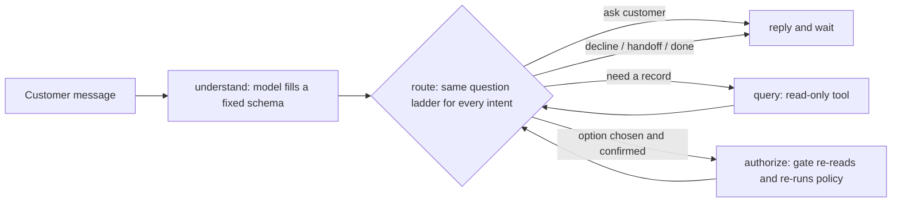

# Agent workflow (policy v1)

This document describes the **implemented** backend after the policy-v1
redesign. The policy file is the single source of truth; the graph contains
no intent-specific branches.

## Responsibilities

| Component | Decides | Never decides |
| --- | --- | --- |
| `llm_interpreter.py` (model) | What the customer said: identity details, new requests, order/item/coupon, answers to questions, option choice, yes/no | Eligibility, amounts, payloads, which tool to call |
| `agent/policy/engine.py` | Which facts are still needed, and whether the policy declines, hands off, or offers options with exact payloads | Anything about language |
| `graph.py` `route` | The next step, by asking the policy engine | Policy content |
| `policy_gate.py` | Whether a confirmed option is still allowed after re-reading records | Which option the customer wants |
| `action_ledger.py` | Nothing; it verifies and records | — |

## The route ladder

Every turn, for the first open request:

1. Is there a request? If the customer raised something outside the eight
   intents, say so right away and record a handoff.
2. Is the customer verified? Policy methods: email, or full name + zip code.
   An account ID alone is not enough. Once verified, identity is locked for
   the conversation.
3. Are the targets known? Order ID (then `lookup_order`), item (matched by
   name or the only item), coupon code.
4. Does the engine have every fact it needs? System facts come first
   (`lookup_order`, `check_coupon`); if a system record has no value and the
   policy allows it, the customer is asked. Only facts that can still change
   the outcome are asked.
5. Decision: `decline` explains and closes the request; `handoff` closes it
   for a human; `options` are offered.
6. The customer picks an option and says yes; then `authorize`. "No" closes
   the request with no change. New details after an offer (another item, a
   different answer) make the engine decide again.

Requests are handled one at a time; a resolved, declined, or handed-off
request moves on to the next one in the same turn.

## What is recorded

* `cp1_events`: one entry each time `route` ends a step: request, intent,
  next step, planned tool, and what was asked.
* `cp2_events`: each policy decision (options with rule ID, decline, handoff)
  and each authorization result.
* Ledger (`action_events_v2`): exactly one final row per request:
  `simulated`, `blocked`, `declined`, `customer_declined`, or `handoff`, with
  the policy rule ID and policy version.

Labels and evaluation runs for CP1/CP2/full conversations are the next phase;
these records are what they will read.

## Known limits

* The model adapter is schema-only and has not been re-run live after the
  redesign. Replies are templates, not model-phrased.
* Customer statements (receipt, purchase date) are accepted and labeled
  `source=customer`; there is no evidence upload.
* No supervisor-approval tier; v1 has confirm-then-execute and handoff only.
* Oracle fixtures are still project-made and not linked to all ABCD promo
  cases; for guests without a usable Oracle verdict the request is handed off.
